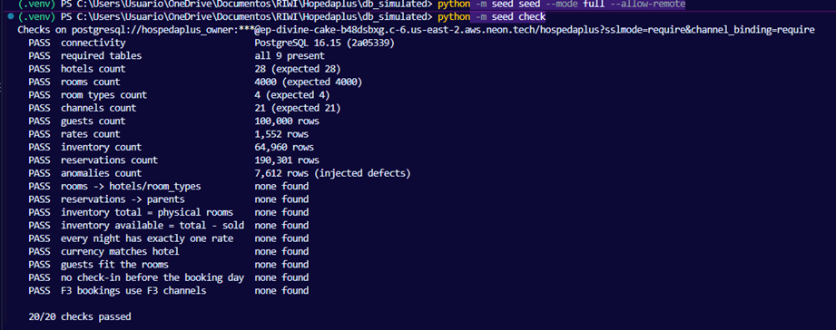

# Deployment: F3 database on Neon

The shared F3 database runs on [Neon](https://neon.com) (managed PostgreSQL),
in AWS US East (Ohio). The repo only needs a `DATABASE_URL`, so nothing in
the code is Neon-specific.

| | |
|---|---|
| Neon project | `hospedaplus_database`, branch `production`, Free plan |
| Region | AWS US East (Ohio), `aws-us-east-2` |
| Endpoint | `ep-divine-cake-b48dsbxg` (pooled host `ep-divine-cake-b48dsbxg-pooler.c-6.us-east-2.aws.neon.tech`) |
| Database | `hospedaplus`, PostgreSQL 16 |
| Roles | `hospedaplus_owner` (seed), `hospedaplus_api` (API and Kafka consumers), `hospedaplus_reader` (team and Airflow) |
| Data | `full` mode, loaded 2026-10-15 from a laptop, **old catalog**: reload to move to shared catalog 1.0.0 |
| Health | `python -m seed check`: 20/20 passed (21 checks after the reload) |



## How it was set up

1. **Project.** In [console.neon.tech](https://console.neon.tech): new project
   `hospedaplus_database`, Postgres database `hospedaplus`, version 16,
   region AWS US East (Ohio). All other services (object storage, functions,
   AI gateway, realtime, auth) left off.
2. **Connection string.** **Connect** → branch `production`, database
   `hospedaplus`, **connection pooling off**:

   ```
   postgresql://hospedaplus_owner:<password>@ep-divine-cake-b48dsbxg.c-6.us-east-2.aws.neon.tech/hospedaplus?sslmode=require&channel_binding=require
   ```

   The direct host (no `-pooler`) is for the seed, which creates tables and
   bulk-loads with `COPY`. The `-pooler` host suits clients with many short
   connections, such as the API.
3. **Load and check**, from a terminal with the URL set only for that session:

   ```powershell
   $env:DATABASE_URL = "<connection string>"
   python -m seed init
   python -m seed seed --mode full --allow-remote
   python -m seed check
   Remove-Item Env:DATABASE_URL
   ```

   `--allow-remote` is required for any command that replaces data on a
   non-local database. The load runs in one transaction: if it fails half
   way, Neon keeps its previous data.

## Roles

Each client gets the least access it needs, so a bug or a leaked URL in one
place cannot wipe the data.

| Role | Used by | Can |
|---|---|---|
| `hospedaplus_owner` | seed (`init`, `seed`, reloads) | everything; created with the project |
| `hospedaplus_api` | FastAPI, Kafka consumers | read all tables; `UPDATE inventory`; `INSERT`/`UPDATE` reservations and guests; never delete |
| `hospedaplus_reader` | team (DBeaver, psql), Airflow bronze worker | read only |

The two limited roles were created **with SQL in the SQL Editor**, not with
**Add role** in the console: roles created in the console join
`neon_superuser` and can write every table. Run as `hospedaplus_owner`:

```sql
/* Read-only: team and Airflow bronze worker */
CREATE ROLE hospedaplus_reader WITH LOGIN PASSWORD '<password>';
GRANT CONNECT ON DATABASE hospedaplus TO hospedaplus_reader;
GRANT USAGE ON SCHEMA public TO hospedaplus_reader;
GRANT SELECT ON ALL TABLES IN SCHEMA public TO hospedaplus_reader;
ALTER DEFAULT PRIVILEGES FOR ROLE hospedaplus_owner IN SCHEMA public
    GRANT SELECT ON TABLES TO hospedaplus_reader;

/* API: FastAPI and Kafka consumers.
   Reads everything; writes only inventory, reservations and guests. */
CREATE ROLE hospedaplus_api WITH LOGIN PASSWORD '<password>';
GRANT CONNECT ON DATABASE hospedaplus TO hospedaplus_api;
GRANT USAGE ON SCHEMA public TO hospedaplus_api;
GRANT SELECT ON ALL TABLES IN SCHEMA public TO hospedaplus_api;
GRANT UPDATE ON inventory TO hospedaplus_api;
GRANT INSERT, UPDATE ON reservations, guests TO hospedaplus_api;
GRANT USAGE ON ALL SEQUENCES IN SCHEMA public TO hospedaplus_api;
```

- **Passwords:** Neon rejects weak ones. Use letters, digits, `-` and `_`
  only, so the URL needs no escaping:
  `python -c "import secrets; print(secrets.token_urlsafe(24))"`.
- **Reloads keep the grants:** the seed empties tables with `TRUNCATE`, it
  does not drop them.
- **New tables:** `hospedaplus_reader` sees them automatically (default
  privileges); `hospedaplus_api` needs its own `GRANT` for each table it
  writes.
- **Check:** connected as `hospedaplus_reader`, `DELETE FROM hotels;` must
  fail with `permission denied`.

## How the team connects

Team members are in the Neon organization, so each person reads the
connection details in the console. Nobody sends passwords over chat.

### 1. Get the connection details

[console.neon.tech](https://console.neon.tech) → project `hospedaplus_database`
→ **Connect** → branch `production`, database `hospedaplus`, your role.

| Field | Value |
|---|---|
| Host | `ep-divine-cake-b48dsbxg-pooler.c-6.us-east-2.aws.neon.tech` (pooled) or `ep-divine-cake-b48dsbxg.c-6.us-east-2.aws.neon.tech` (direct) |
| Port | `5432` |
| Database | `hospedaplus` |
| User | `hospedaplus_reader` (team) |
| SSL | required (`sslmode=require`) |

Ready-to-use URLs; only the password is missing (ask the database owner
privately; it is never written in the repo):

| Role | URL |
|---|---|
| `hospedaplus_reader` | `postgresql://hospedaplus_reader:<password>@ep-divine-cake-b48dsbxg-pooler.c-6.us-east-2.aws.neon.tech/hospedaplus?sslmode=require` |
| `hospedaplus_api` | `postgresql://hospedaplus_api:<password>@ep-divine-cake-b48dsbxg-pooler.c-6.us-east-2.aws.neon.tech/hospedaplus?sslmode=require` |
| `hospedaplus_owner` (seed) | `postgresql://hospedaplus_owner:<password>@ep-divine-cake-b48dsbxg.c-6.us-east-2.aws.neon.tech/hospedaplus?sslmode=require&channel_binding=require` |

> Port 5432 is Neon's. Your local Docker database uses 5437
> (`POSTGRES_PORT` in `.env`), so the two never clash.

### 2. Pooled or direct host

**Connection pooling** in **Connect** switches the host to `-pooler`. Neon
then puts PgBouncer in front of the database: many client connections share
a few real ones. The Free compute accepts about 100 direct connections; the
pooler accepts thousands.

The pooler runs in transaction mode: two transactions may use different real
connections, so anything that needs one fixed session (a lasting `SET`,
temporary tables, `LISTEN/NOTIFY`, long bulk loads) goes direct.

| Client | Host |
|---|---|
| FastAPI, Kafka consumers, Airflow | pooled: many short connections |
| Seed (`init`, `COPY` load) | direct |
| Team in DBeaver or psql | either; pooled by default, so everyone uses the same URL |

### 3. Connect

**DBeaver / pgAdmin:** new PostgreSQL connection with the fields above; in
the SSL tab set mode `require`. The first query can take a few seconds while
the database wakes up.

**psql:**

```bash
psql "postgresql://hospedaplus_reader:<password>@ep-divine-cake-b48dsbxg-pooler.c-6.us-east-2.aws.neon.tech/hospedaplus?sslmode=require"
```

**This repo, read-only check** (URL set only for that terminal):

```bash
# bash / macOS
export DATABASE_URL="postgresql://hospedaplus_reader:<password>@ep-divine-cake-b48dsbxg-pooler.c-6.us-east-2.aws.neon.tech/hospedaplus?sslmode=require"
python -m seed check
unset DATABASE_URL
```

```powershell
# PowerShell
$env:DATABASE_URL = "<same URL>"
python -m seed check
Remove-Item Env:DATABASE_URL
```

### 4. Services in AWS

No service has the endpoint in its code: each one reads `DATABASE_URL`. In
AWS the full URL lives in **Secrets Manager**, one secret per role
(`hospedaplus/neon/api`, `hospedaplus/neon/reader`); on a laptop it goes in
the git-ignored `.env`. If Neon changes the endpoint or a password is reset,
only the secret changes.

## Good to know

- **Free plan limits:** 1 GB storage (full mode uses ~75 MB) and 100
  CU-hours of compute per month. The database sleeps after 5 minutes idle and
  wakes on the next query, so batch jobs stay free; something querying it
  around the clock would not.
- **Credentials** are shared privately, never committed. If they leak, reset
  them in Neon (**Postgres database → Roles → Reset password**, or
  `ALTER ROLE <role> WITH PASSWORD '...'` in the SQL Editor) and update the
  URLs that use that role. Resetting a password does not change the role's
  privileges.
- **Never run `pytest` against Neon**: the database tests wipe their
  database. `python -m seed check` is read-only and safe at any time.

## Next steps

- [ ] **EC2 in us-east-2 for repeatable loads**, so anyone on the team can
      reload Neon without a laptop (repo + `.venv` + a git-ignored `.env`
      with the Neon URL).
- [ ] **Scheduled reload** (cron on the EC2 or an Airflow task), if the team
      wants the date window to move forward automatically.
- [x] **Read-only role for Airflow**: `hospedaplus_reader`, see [Roles](#roles).
- [ ] **ADR** recording the choice of Neon over RDS and Postgres on EC2,
      with costs and trade-offs.