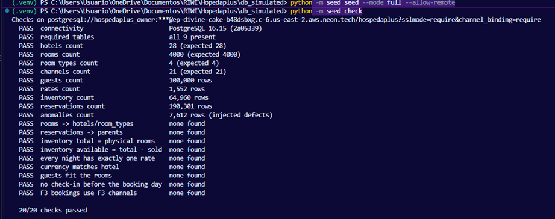

# Deployment: F3 database on Neon

The shared F3 database runs on [Neon](https://neon.com) (managed PostgreSQL),
in AWS US East (Ohio). F3 lives in the **`operation`** schema; F2's event
ledger (repo `buenavista-streaming`) lives in the **`streaming`** schema of
the same database. The repo only needs a `DATABASE_URL`, so nothing in the
code is Neon-specific.

| | |
|---|---|
| Neon project | `hospedaplus_database`, Free plan |
| Branches | `development` (try everything here first) and `production` |
| Region | AWS US East (Ohio), `aws-us-east-2` |
| Endpoint (production) | `ep-divine-cake-b48dsbxg` (pooled host `ep-divine-cake-b48dsbxg-pooler.c-6.us-east-2.aws.neon.tech`). The `development` branch has its own endpoint: copy it from **Connect**. |
| Database | `hospedaplus`, PostgreSQL 16 |
| Schemas | `operation` (F3, this repo), `streaming` (F2 ledger) |
| Roles | `hospedaplus_owner` (seed, migrations), `app_writer` (API, consumers, simulator), `etl_reader` (Airflow, team; read-only) |



> The first F3 load (2026-10-15) went to the `public` schema with the old
> roles `hospedaplus_api` / `hospedaplus_reader`. Once `operation` is loaded
> and checked on `production`, those `public` tables and roles can be dropped.

## Load or reload F3 (development first)

1. **Connection string.** Neon console → **Connect** → branch
   `development`, database `hospedaplus`, role `hospedaplus_owner`,
   **connection pooling off** (direct host, no `-pooler`):

   ```
   postgresql://hospedaplus_owner:<password>@<endpoint>.c-6.us-east-2.aws.neon.tech/hospedaplus?sslmode=require&channel_binding=require
   ```

   The direct host is for the seed, which creates tables and bulk-loads
   with `COPY`.
2. **Load and check with Docker** (no Python needed). Put the URL in your
   git-ignored `.env` as `NEON_OWNER_URL`, then:

   ```powershell
   docker compose run --rm --build neon-seed    # init + full seed + 24 checks
   docker compose run --rm neon-check           # checks again, any time
   ```

   **Or with Python**, from a terminal with the URL set only for that session:

   ```powershell
   $env:DATABASE_URL = "<connection string>"
   python -m seed init                             # schema, tables, indexes, functions
   python -m seed seed --mode full --allow-remote  # replaces F3 data in one transaction
   python -m seed check                            # 24 checks, must all pass
   Remove-Item Env:DATABASE_URL
   ```

   `--allow-remote` is required for any command that replaces data on a
   non-local database. If the load fails half way, Neon keeps its previous
   data. `init` is safe to re-run: it never drops anything and updates the
   functions in place.
3. **Try it by hand** in the SQL Editor (branch `development`):

   ```sql
   SELECT table_name FROM information_schema.tables
   WHERE table_schema = 'operation' ORDER BY 1;          -- 14 tables

   SELECT * FROM operation.reservar('direct_web', 'PRUEBA-1', 'HP-CO-001', 'DOUBLE', 'G-0000001',
                                    current_date + 10, current_date + 12, 1, 2, true);
   SELECT * FROM operation.penalidad('PRUEBA-1');        -- what cancelling now would cost
   SELECT * FROM operation.cancelar('PRUEBA-1');         -- cancel and free the nights
   ```
4. When everything passes on `development`, repeat steps 1–2 on `production`.

`seed` keeps `local_events` and `cancellation_rate_by_lead` (F6 and Spark own
them) but empties `reservation_rejections` and `relocations`, because they
point at reservation ids that the reload reuses.

## Roles

Each client gets the least access it needs, so a bug or a leaked URL in one
place cannot wipe the data. The schemas and roles were created once, by
`hospedaplus_owner` in the SQL Editor (passwords are never written in the
repo):

```sql
CREATE SCHEMA IF NOT EXISTS operation;
CREATE SCHEMA IF NOT EXISTS streaming;
CREATE ROLE app_writer LOGIN PASSWORD '***';
CREATE ROLE etl_reader LOGIN PASSWORD '***';

GRANT USAGE ON SCHEMA operation, streaming TO app_writer, etl_reader;
GRANT SELECT, INSERT, UPDATE, DELETE ON ALL TABLES IN SCHEMA operation, streaming TO app_writer;
GRANT USAGE, SELECT ON ALL SEQUENCES IN SCHEMA operation, streaming TO app_writer;
GRANT SELECT ON ALL TABLES IN SCHEMA operation, streaming TO etl_reader;
ALTER ROLE etl_reader SET default_transaction_read_only = on;

-- tables created later by the owner (seed, migrations) get the same grants
ALTER DEFAULT PRIVILEGES FOR ROLE hospedaplus_owner IN SCHEMA operation, streaming
  GRANT SELECT, INSERT, UPDATE, DELETE ON TABLES TO app_writer;
ALTER DEFAULT PRIVILEGES FOR ROLE hospedaplus_owner IN SCHEMA operation, streaming
  GRANT USAGE, SELECT ON SEQUENCES TO app_writer;
ALTER DEFAULT PRIVILEGES FOR ROLE hospedaplus_owner IN SCHEMA operation, streaming
  GRANT SELECT ON TABLES TO etl_reader;
```

| Role | Used by | Can |
|---|---|---|
| `hospedaplus_owner` | `seed init`, `seed seed`, F2 migrations | everything; created with the project |
| `app_writer` | FastAPI, F2 Kafka consumer, F4 DAG, `seed simulate` | read and write rows, call `reservar()` and friends; never create or drop tables |
| `etl_reader` | Airflow bronze worker, team (DBeaver, psql), `seed check` | read only, even through functions (`reservar()` fails with "read-only transaction") |

- **Always run `init` and `seed` as `hospedaplus_owner`.** The default
  privileges above only apply to tables that role creates.
- **Functions need no extra grant:** PostgreSQL lets every role execute
  them, and they run with the caller's own rights.
- **`reset` keeps the `operation` schema** (it drops tables and functions
  only), so the grants on the schema survive.
- **Check:** connected as `etl_reader`, `DELETE FROM operation.reservations;`
  must fail; connected as `app_writer`, `DROP TABLE operation.reservations;`
  must fail with "must be owner".
- Roles created with **Add role** in the console join `neon_superuser` and
  can write every table: create them with SQL, as above.

## How the team connects

Team members are in the Neon organization, so each person reads the
connection details in the console. Nobody sends passwords over chat.

[console.neon.tech](https://console.neon.tech) → project `hospedaplus_database`
→ **Connect** → branch, database `hospedaplus`, your role.

| Role | URL (password from Neon, never from the repo) |
|---|---|
| `etl_reader` | `postgresql://etl_reader:<password>@<endpoint>-pooler.c-6.us-east-2.aws.neon.tech/hospedaplus?sslmode=require` |
| `app_writer` | `postgresql://app_writer:<password>@<endpoint>-pooler.c-6.us-east-2.aws.neon.tech/hospedaplus?sslmode=require` |
| `hospedaplus_owner` (seed) | `postgresql://hospedaplus_owner:<password>@<endpoint>.c-6.us-east-2.aws.neon.tech/hospedaplus?sslmode=require&channel_binding=require` |

> Neon and your local Docker database can both use port 5432: one is on
> the internet, the other on `localhost`.

### Pooled or direct host

**Connection pooling** in **Connect** switches the host to `-pooler`. Neon
then puts PgBouncer in front of the database, in transaction mode: two
transactions may use different real connections, so anything that needs one
fixed session (a lasting `SET`, temporary tables, long bulk loads) goes
direct. That's why the code always writes `operation.` in front of table
names, or uses `SET LOCAL search_path` inside the transaction.

| Client | Host |
|---|---|
| FastAPI, Kafka consumers, Airflow, simulator | pooled: many short connections |
| Seed (`init`, `COPY` load) | direct |
| Team in DBeaver or psql | either |

### Keep F3 "live": the simulator

F3 is a continuous source. After the load, run the simulator with the
`app_writer` URL (pooled host). It books through `operation.reservar()`
every few seconds, cancels some bookings, and adds a new night to inventory
and rates every day:

```powershell
$env:DATABASE_URL = "<app_writer URL>"
python -m seed simulate --per-minute 6     # Ctrl+C to stop
```

Or in Docker: put the URL in `.env` as `NEON_APP_URL` and run
`docker compose up neon-simulator`. On AWS it is the same image as the seed
job, with command `simulate`.

### Services in AWS

No service has the endpoint in its code: each one reads `DATABASE_URL`. In
AWS the full URL lives in **Secrets Manager**, one secret per role
(`hospedaplus/neon/app_writer`, `hospedaplus/neon/etl_reader`); on a laptop
it goes in the git-ignored `.env`.

## Good to know

- **Free plan limits:** 1 GB storage and 100 CU-hours of compute per month.
  The database sleeps after 5 minutes idle; a simulator running around the
  clock keeps it awake, so stop it when you are not demoing.
- **Credentials** are shared privately, never committed or pasted in chats.
  If one leaks, reset it right away (`ALTER ROLE <role> WITH PASSWORD '...'`
  in the SQL Editor, or **Roles → Reset password**) and update the URLs that
  use it. Resetting a password does not change the role's privileges.
- **Never run `pytest` against Neon**: the database tests wipe their
  database (and `test/conftest.py` refuses non-local URLs).

## Next steps

- [ ] F2 consumer (`buenavista-streaming`) calls `operation.reservar()` /
      `liberar()` in the same transaction as the ledger insert.
- [ ] Airflow DAG `limites_sobreventa_diario`: Spark writes
      `cancellation_rate_by_lead`, then `SELECT operation.refresh_overbooking_limits();`.
- [ ] Airflow DAG `reubicacion_diaria`: writes `relocations`, then
      `operation.liberar(code, 'relocated')`.
- [ ] Drop the old `public` tables and roles once `production` runs on `operation`.
- [ ] **ADR** recording the choice of Neon over RDS and Postgres on EC2.
